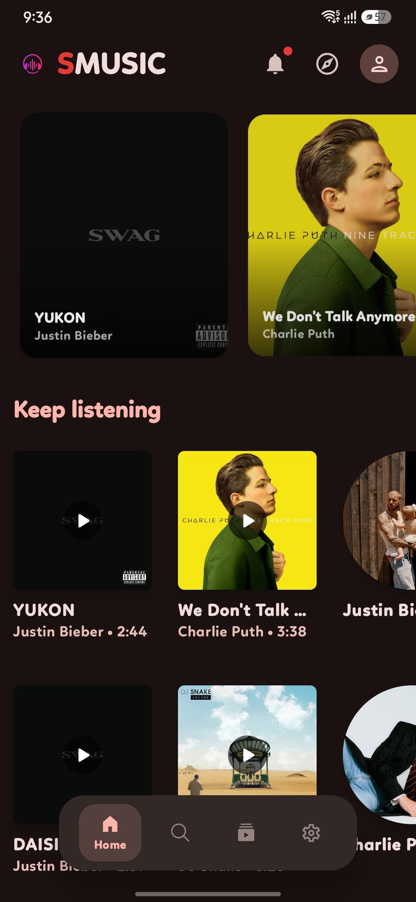
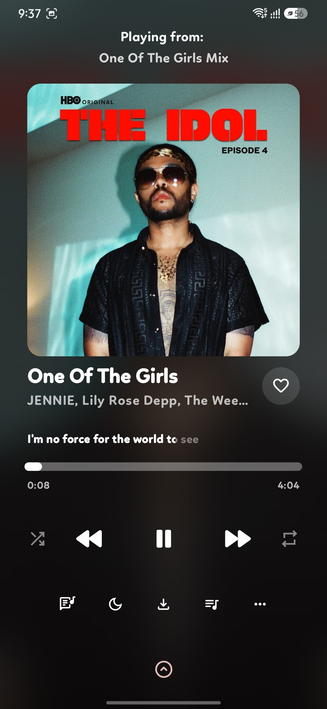
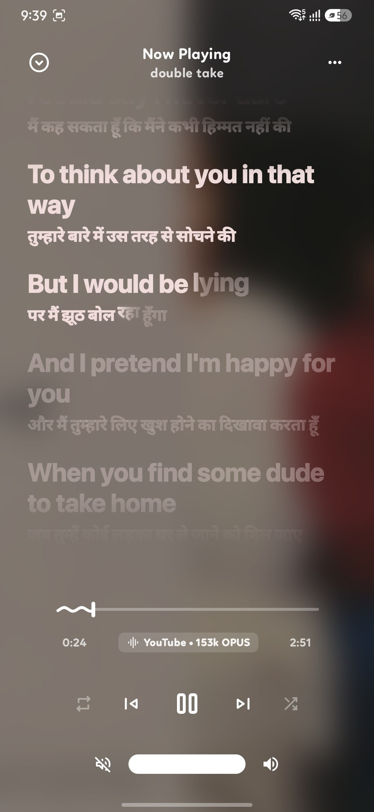
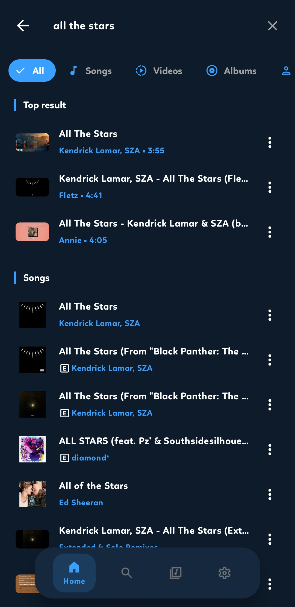
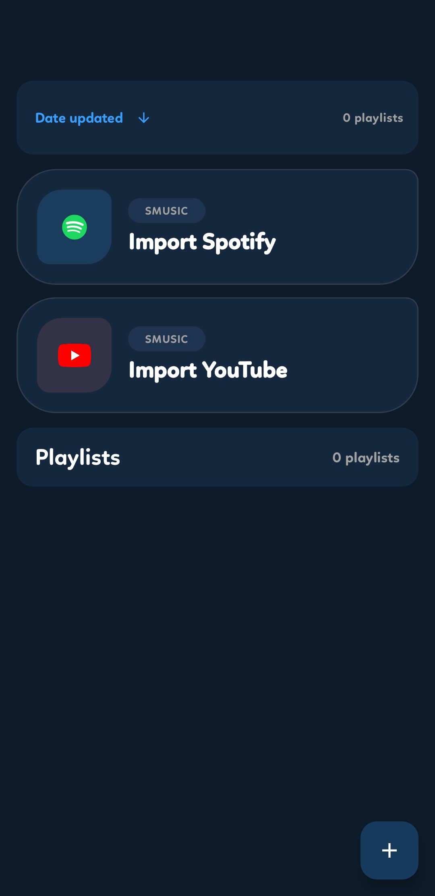
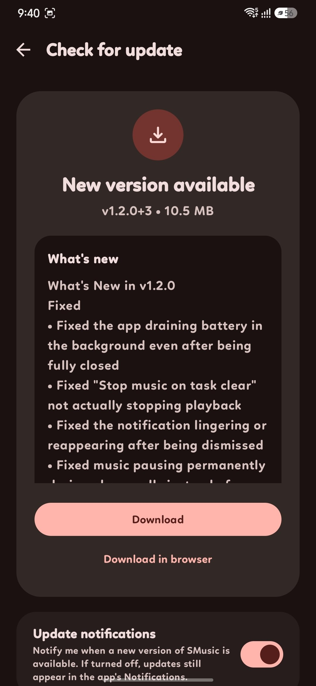

<div align="center">


# SMusic

**Stream, download, and enjoy music — free, ad-free, and yours to customize.**

[](LICENSE)
[](#)
[](#)
[](#)

</div>

---

## Table of Contents

- [About](#about)
- [Features](#features)
- [Screenshots](#screenshots)
- [Tech Stack](#tech-stack)
- [Modules](#modules)
- [Building From Source](#building-from-source)
- [FAQ](#faq)
- [Contributing](#contributing)
- [Security](#security)
- [License](#license)

---

> [!NOTE]
> ### 💡 Note Regarding Repository History & Initial Commit
> This repository was made public **after the project had already been fully developed locally**. 
> As a result, the initial public commit contains the complete existing codebase and shows a large number of additions (~136k). 
> All subsequent updates, fixes, and active development are properly tracked through individual commits moving forward.

---

## About

SMusic is a free, open-source Android music app that streams from YouTube Music, with offline downloads, synced lyrics, music recognition, and a deep set of customization options — including **11 distinct in-app player styles** you can switch between, each with its own look, layout, and controls.

No subscription, no ads, no account required to start listening. Everything runs from your own device, talking directly to YouTube Music's own catalog.

## Features

### 🎵 Playback
- Stream millions of songs directly from YouTube Music, free and ad-free
- Background playback with full media-notification and lock-screen controls
- Gapless, high-quality audio via Media3 / ExoPlayer
- Home-screen widget for quick playback controls
- Sleep timer with a live countdown
- Shuffle, repeat (all/one), and full queue management
- Radio / similar-song recommendations

### ⬇️ Offline
- Download individual songs or entire playlists for offline listening
- Downloads survive app updates and are managed from a dedicated storage screen
- Low Data Mode — automatically drops to a lower audio quality on mobile data to save your plan

### 📝 Lyrics
- Real-time synced lyrics, sourced from multiple providers (LRCLIB, KuGou, BetterLyrics, YouTube's own captions)
- Full-screen lyrics view with smooth line-by-line highlighting
- Share a lyric line as a styled image card

### 🎤 Discovery
- Built-in music recognition — identify any song playing around you
- Import your existing playlists straight from Spotify or YouTube Music
- Explore screen with mood- and genre-based browsing
- Search across songs, videos, albums, and artists, with filters
- Full library management — songs, albums, artists, and playlists, each with their own screen

### 🎨 Customization
- **11 player styles** to choose from: Classic, Spotify, Apple, Galaxy, Fold, Frost, Paper, Liquid, CloudGlow, Groove, Popsy, and more — each with its own layout
- 3 seek-bar styles per player: Default, Squiggly (animated wave), and Slim
- Classic player dynamically colors itself from each song's own artwork
- Custom theme presets and accent colors
- Customizable, reorderable navigation bar
- Built-in equalizer
- Multi-language support

### 📊 Your Library, Your Stats
- Listening history
- Personal listening insights — your top songs, artists, and albums
- Full backup & restore of your library, playlists, and settings

### 🔔 Stays Up To Date, On Its Own
- In-app notification bell for announcements
- Automatic background update checks — no need to check manually
- Browse previous versions and their changelogs right from the About screen
- Device-performance-aware animations (automatically lighter on lower-end devices)

## Screenshots

<p align="center">
  
  
  
</p>
<p align="center">
  
  
  
</p>

## Tech Stack

- **Kotlin** — 100% Kotlin codebase
- **Jetpack Compose** (Material 3 Expressive) — fully declarative UI, no XML layouts
- **Media3 / ExoPlayer** — playback engine
- **Room** — local database for library, playlists, and history
- **Hilt** — dependency injection
- **Coil** — image loading and caching
- **KSP** — annotation processing
- **Custom InnerTube client** — talks directly to YouTube Music's own internal API

## Modules

| Module | Purpose |
|---|---|
| `app` | Main application — UI, playback, database, settings |
| `innertube` | YouTube Music InnerTube API client |
| `kugou` | KuGou lyrics provider |
| `lrclib` | LRCLIB lyrics provider |
| `betterlyrics` | BetterLyrics provider |
| `shazamkit` | Music recognition |
| `jossredconnect` | Auth / backend connector |
| `material-color-utilities` | Google's Material color science library |

## Building From Source

### Requirements

- Android Studio (latest stable)
- JDK 17+
- Android SDK — `compileSdk 36`, `minSdk 24`, `targetSdk 35`

### Setup

1. **Clone the repo:**
   ```bash
   git clone https://github.com/<your-username>/SMusic.git
   ```

2. **Create `local.properties`** in the project root (this file is git-ignored — it never gets pushed):
   ```properties
   sdk.dir=/path/to/your/Android/Sdk

   # Optional — only needed if you're running your own update-checker worker
   update.manifest.url=

   # Used for fetching release changelogs and the GitHub link on the About screen
   github.repo=<your-username>/SMusic
   ```

3. **Open the project in Android Studio** and let Gradle sync.

4. **Build and run** on a device or emulator.

To build a *signed* release APK, you'll also need your own `keystore.properties` (also git-ignored) with your signing details:
```properties
storeFile=/path/to/your.keystore
storePassword=yourStorePassword
keyAlias=yourKeyAlias
keyPassword=yourKeyPassword
```

## FAQ

**Is this affiliated with YouTube Music or Google?**
No. SMusic is an independent, unofficial client that uses YouTube Music's own public web API — the same one YouTube Music's own website uses.

**Does it cost anything?**
No. SMusic is completely free and always will be — no subscriptions, no premium tier, no ads.

**Why isn't this on the Play Store?**
Like most InnerTube-based clients, this app isn't distributed through the Play Store. Download the APK directly from this repo's [Releases](../../releases) page.

## Contributing

See [CONTRIBUTING.md](CONTRIBUTING.md) for guidelines on reporting issues and submitting pull requests.

## Security

See [SECURITY.md](SECURITY.md) for how to report a vulnerability.

## License

This project is licensed under the **GNU General Public License v3.0**. See [LICENSE](LICENSE) for the full text.

> Copyleft: any derivative work built from this project must also be open-sourced under GPL-3.0.

